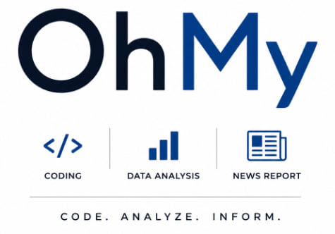

# OhMyCode LLC

Portfolio site of HeeKyoung Chun, ScD — https://sechan9999.github.io/ohmycodellc/

Company website: https://ohmycodellc.com/  
The Playbook and Projects: https://sechan9999.github.io/ai-ml-delivery-playbook/projects.html

Electoral Insight Hub: https://app.ohmycodellc.com/us?lang=en
YouTube: https://youtu.be/DDS0h9IOusg (KO)
         https://youtu.be/hcqtSq5LCcM (EN)

by HK Chun

We just released a 60-second promo for the US Election Insights Hub — our bilingual (EN/KR) 2026 midterm forecast platform.

The video walks through how the model works: 40,000 Monte Carlo simulations with correlated national + regional error, 35 Senate seats and all 435 House districts modeled individually, and county-level analysis across 3,100+ counties.

Current snapshot: Senate Dem majority 53.4%, House 96.6%.

🎬 Watch: https://youtu.be/DDS0h9IOusg
📊 Try it live: https://app.ohmycodellc.com/us

#ElectionForecast #DataScience #USMidterms #MonteCarlo #OpenData

🗺️ 카운티 지도 — https://app.ohmycodellc.com/maps

미국 3,100개 카운티를 한눈에. 2024년 대선 득표율 지도, 2020→2024년 스윙 지도, 그리고 주별 "학력 격차" 지도까지 세 가지 뷰를 오가며 보세요. 대졸 비율과 민주당 득표율의 상관계수 +0.44 — 숫자로 확인하는 미국의 지형.

❓ Ask the Data — https://app.ohmycodellc.com/ask

"텍사스에서 공화당으로 가장 많이 이동한 카운티는?" 영어로 질문하면 AI가 SQL을 짜서 답합니다. 3,100개 카운티 데이터를 직접 쿼리하지 않고도, 말로 물어보고 표로 받는 선거 데이터 탐색.

📣 트럼프 트루스소셜 메시지 분석 — https://app.ohmycodellc.com/us?tab=messages

트럼프의 트루스소셜 포스트를 주제별로 분류하고 시간 흐름에 따라 추적합니다. 무슨 말을, 언제, 얼마나 했는지 — 메시지 전략을 데이터로 읽는 탭.
